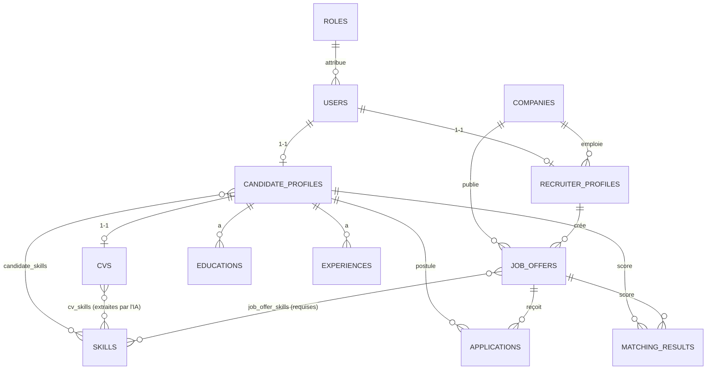

# Modèle de données — SmartRecruit AI

Schéma créé par la migration Flyway `backend/src/main/resources/db/migration/V1__init_schema.sql`.
Les entités JPA correspondantes sont dans `backend/src/main/java/com/smartrecruit/<module>/entity/`.

## Diagramme entité-relation



## Entités

| Entité JPA | Table | Module | Relations principales |
|---|---|---|---|
| `Role` | `roles` | user | 1-N `User` |
| `User` | `users` | user | N-1 `Role` |
| `CandidateProfile` | `candidate_profiles` | candidate | 1-1 `User`, 1-1 `Cv`, 1-N `Education` / `Experience` / `Application`, N-N `Skill` |
| `RecruiterProfile` | `recruiter_profiles` | recruiter | 1-1 `User`, N-1 `Company` |
| `Company` | `companies` | company | 1-N `JobOffer`, 1-N `RecruiterProfile` |
| `JobOffer` | `job_offers` | joboffer | N-1 `Company`, N-1 `RecruiterProfile`, N-N `Skill`, 1-N `Application` |
| `Application` | `applications` | application | N-1 `CandidateProfile`, N-1 `JobOffer` |
| `Cv` | `cvs` | cv | 1-1 `CandidateProfile`, N-N `Skill` |
| `Skill` | `skills` | skill | référentiel partagé |
| `Education` | `educations` | candidate | N-1 `CandidateProfile` |
| `Experience` | `experiences` | candidate | N-1 `CandidateProfile` |
| `MatchingResult` | `matching_results` | matching | N-1 `CandidateProfile`, N-1 `JobOffer` |

## Règles d'intégrité

**Unicité** : email utilisateur, nom d'entreprise, nom de compétence, un profil par utilisateur,
un CV par candidat, **une seule candidature par (candidat, offre)**, un seul résultat de matching par (candidat, offre).

**Suppressions** :

| Suppression de… | Effet |
|---|---|
| un utilisateur candidat | supprime son profil, CV, compétences, formations, expériences, candidatures, scores |
| un utilisateur recruteur | supprime son profil ; ses offres restent à l'entreprise (`recruiter_id` → NULL) |
| une entreprise | supprime ses offres (et leurs candidatures / scores) ; les recruteurs sont détachés |
| une offre | supprime ses candidatures et scores |
| un rôle utilisé | **refusée** |

**Contraintes CHECK** : valeurs des statuts et types de contrat, score et sous-scores entre 0 et 100,
salaire max ≥ salaire min, dates de fin ≥ dates de début, années d'expérience ≥ 0, taille de fichier > 0.

## Choix de conception

- **Un rôle par utilisateur** : les trois rôles sont exclusifs (un compte est soit candidat, soit recruteur, soit admin).
- **Profils séparés de `User`** : `User` ne contient que l'authentification ; les données métier sont dans les profils.
- **`Skill` est un référentiel** : la même compétence (« Java ») est partagée entre profils, CV et offres,
  ce qui rend le matching fiable (comparaison d'identifiants plutôt que de texte libre).
- **Compétences déclarées vs extraites** : `candidate_skills` (saisies par le candidat) et `cv_skills`
  (extraites par l'IA) sont distinctes, pour que le recruteur voie ce que l'IA a trouvé.
- **`MatchingResult` indépendant de `Application`** : un candidat peut consulter son score avant de postuler.
  Les sous-scores, compétences trouvées/manquantes et la version de l'algorithme rendent le score explicable.
- **Le fichier CV n'est pas en base** : seul son nom de stockage (aléatoire) l'est ; le PDF reste dans `UPLOAD_DIR`.
- **Enums stockés en texte** (`VARCHAR` + `CHECK`), lisibles en base et faciles à faire évoluer par migration.
- **Dates en UTC** (`DATETIME(6)`).

## Vérifier le schéma

```powershell
# Structure (tables, clés étrangères, contraintes)
Get-Content database/tests/verify_schema.sql | docker exec -i smartrecruit-mysql sh -c 'mysql -t -u"$MYSQL_USER" -p"$MYSQL_PASSWORD" smartrecruit'
# Comportement des contraintes (transaction annulée, la base n'est pas modifiée)
Get-Content database/tests/verify_constraints.sql | docker exec -i smartrecruit-mysql sh -c 'mysql -t --force -u"$MYSQL_USER" -p"$MYSQL_PASSWORD" smartrecruit'
```
